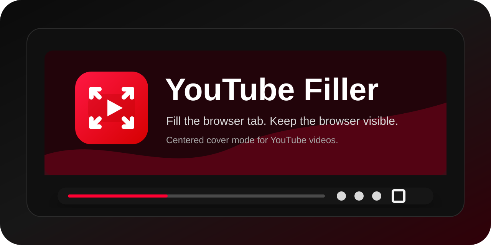

# YouTube Filler



YouTube Filler is a lightweight Chrome and Brave extension that adds a native-looking control to the YouTube player. It lets the video fill the browser tab viewport with a centered `cover` crop, while keeping the browser tabs, address bar and window controls visible.

The extension only runs on normal YouTube watch pages. It does not run on Shorts, search, the YouTube home page or embedded players.

## Features

- Adds a YouTube-style button next to the fullscreen control.
- Fills the current browser tab without entering real browser fullscreen.
- Uses a centered `object-fit: cover` crop to avoid black bars.
- Keeps YouTube playback controls available.
- Hides distracting page panels while the fill mode is active.
- Works with YouTube single-page navigation between videos.
- Includes a configurable in-page shortcut.
- Supports English (US) by default and Spanish (Spain) for any `es-*` browser locale.

## Shortcuts

- In-page shortcut: `º` by default, intended for Spanish keyboards where the key is to the left of `1`.
- Native browser command: `Alt+Shift+V` by default.
- Exit shortcut: `Escape` while YouTube Filler is active and the browser is not in real fullscreen.

The in-page shortcut only works when the YouTube tab has focus. To use a shortcut from other apps, configure the native browser command as Global in `chrome://extensions/shortcuts` or `brave://extensions/shortcuts`.

## Install Locally

1. Download or clone this repository.
2. Open `chrome://extensions` or `brave://extensions`.
3. Enable **Developer mode**.
4. Click **Load unpacked**.
5. Select the project folder.
6. Open a normal YouTube video at `https://www.youtube.com/watch?...`.

After changing files, reload the extension from `chrome://extensions` or `brave://extensions`.

## Build a Store Package

This extension has no build step and no external dependencies. To package it manually, zip the extension files while excluding git metadata and local temporary files.

A PowerShell helper is included:

```powershell
./scripts/package.ps1
```

The package will be created in `dist/`.

## Privacy

YouTube Filler does not collect analytics, does not track browsing history, does not sell data and does not send video information to any external server. Settings are stored with Chrome's extension storage so your shortcut preference can sync through the browser if sync is enabled.

See [PRIVACY.md](PRIVACY.md) for the full privacy policy.

## Support

Issues and feature requests are handled through GitHub Issues. A small support link is also shown in the extension popup: [Buy me a coffee](https://buymeacoffee.com/enriqueite).

## License

This project is licensed under the GNU General Public License v3.0. See [LICENSE](LICENSE).

---

# YouTube Filler en español

YouTube Filler es una extensión ligera para Chrome y Brave que añade un control con aspecto nativo al reproductor de YouTube. Permite que el vídeo rellene la pestaña del navegador con un recorte centrado tipo `cover`, manteniendo visibles las pestañas, la barra de direcciones y los controles de la ventana.

La extensión solo se ejecuta en páginas normales de reproducción de YouTube. No se activa en Shorts, búsqueda, portada de YouTube ni reproductores embebidos.

## Funciones

- Añade un botón estilo YouTube junto al control de pantalla completa.
- Rellena la pestaña actual sin entrar en pantalla completa real del navegador.
- Usa recorte centrado con `object-fit: cover` para evitar bandas negras.
- Mantiene accesibles los controles de reproducción de YouTube.
- Oculta paneles molestos de la página mientras el modo está activo.
- Soporta la navegación interna de YouTube entre vídeos.
- Incluye un atajo interno configurable.
- Usa inglés de EE. UU. por defecto y español de España para cualquier configuración de navegador `es-*`.

## Atajos

- Atajo interno: `º` por defecto, pensado para teclados españoles donde la tecla está a la izquierda del `1`.
- Comando nativo del navegador: `Alt+Shift+V` por defecto.
- Salida rápida: `Escape` mientras YouTube Filler está activo y el navegador no está en pantalla completa real.

El atajo interno solo funciona cuando la pestaña de YouTube tiene foco. Para usar un atajo desde otras apps, configura el comando nativo del navegador como Global en `chrome://extensions/shortcuts` o `brave://extensions/shortcuts`.
